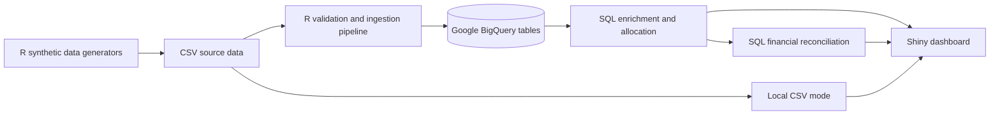

Music Revenue Intelligence
An end-to-end music revenue analysis and reconciliation project built with R, SQL, Google BigQuery and Shiny.

Streaming data tells us how many times a recording was played. But what do those streams mean commercially? Which markets and artists generate revenue, what explains changes between months, and do the amounts allocated to labels agree with the financial records?

I built this project to explore those questions through a reproducible data pipeline and an interactive dashboard. It brings together my interests in music, economics and data storytelling, with an emphasis on explaining financial performance and identifying issues worth investigating.
Portfolio project — synthetic data only. All artists, labels, streaming activity, commercial rates, distribution agreements, FX assumptions and financial records are fictional. The project is not affiliated with a music company or streaming service.

Commercial Performance: an overview of simulated revenue, streams, expected label revenue and monetisation across markets.
At a glance
	Extended demonstration dataset
Reporting period	January–June 2026
Markets	5 — US, UK, Germany, Japan and South Korea
Streaming platforms	3
Fictional artists / tracks	10 / 30
Track-level streaming records	2,700
Monthly label–market reconciliation groups	90
Deliberately seeded reconciliation exceptions	2

Questions I wanted to answer
- Commercial performance: Which platforms, markets and artists contribute most to streaming revenue, and how efficiently does each market monetise streams?
- Revenue movements: Is growth explained by more streams, changes in geographic market mix, or changes in revenue per stream?
- Financial controls: Do expected label allocations agree with recorded amounts, and which differences need investigation?
- Operational follow-up: How can an analyst document discrepancies, communicate findings and propose corrective action?
How the system works

Layer	Implementation
Data generation	R creates synthetic streaming statements, catalogue records, distribution agreements, ledger entries and optional fictional FX/deal terms.
Ingestion and quality checks	R validates source records, loads tables into BigQuery and refreshes SQL reporting views.
Transformation	BigQuery SQL joins streaming activity to catalogue and agreements, calculates label allocations and compares them with the finance ledger.
Analysis and reporting	R Shiny, Plotly and DT provide interactive revenue analysis, financial exception reporting, commentary and illustrative deal operations.

The dashboard can use BigQuery or local CSVs. Its Refresh data button reloads the chosen source; it does not rerun or schedule the ingestion pipeline.
Dashboard walkthrough
1. Commercial Performance — explaining the numbers
The commercial dashboard tracks gross revenue, stream counts, revenue per 1,000 streams and expected label revenue. Users can filter the results by reporting period, market, label and platform.

Rather than only reporting a month-on-month increase, I built a revenue bridge that decomposes the change into three components:
1. Streaming volume: the effect of changes in the number of streams.
2. Market mix: the effect of streams shifting between differently monetising markets.
3. Within-market monetisation: the effect of changes in revenue per stream within each market.

Revenue bridge and commentary: the simulated May–June increase of £945.15 is decomposed into a £834.76 volume contribution, a −£27.25 market-mix contribution and a £137.64 within-market monetisation contribution.

The system also generates plain-language observations about revenue drivers, market concentration and potential commercial implications. In the example shown, the United States accounts for 39.5% of selected revenue and has the highest revenue per 1,000 streams (£3.11).

These are descriptive calculations: the bridge reconciles mathematically but does not establish the causes of changes in listener behaviour or platform payments.

<strong>More commercial analysis: platforms, artists and anomaly monitoring</strong>

The platform chart compares revenue by market, while the artist table brings together streams, gross revenue, revenue per 1,000 streams and contribution to the selected total.

I also included an exploratory three-month rolling z-score monitor for market revenue and monetisation, flagging deviations beyond two standard deviations. With only six months of demonstration data, this is a screening illustration—not a reliable production anomaly detector or evidence of a financial error.

2. Revenue Reconciliation — detecting discrepancies
The reconciliation compares calculated label allocations against the recorded simulated finance ledger:
Expected label revenue = Gross streaming revenue (GBP) × Fictional label share
Variance = Recorded label revenue − Expected label revenue
Allocations are aggregated to month × label × market before matching. Missing counterparts are exceptions; otherwise, differences are classified as exceptions when the absolute variance, rounded to two decimal places, is greater than £0.50. Small rounding residuals within tolerance do not inflate the financial exposure figures.

The six-month extended scenario produces 88 matches out of 90 groups (97.8%). Two discrepancies were deliberately inserted to test the workflow:
Simulated exception	Recorded minus expected
Jan 2026 · Juniper Sound · Germany	+£125.40
Feb 2026 · Juniper Sound · United Kingdom	−£90.00
Absolute exception exposure	£215.40
Net exception variance	+£35.40

The distinction between absolute exposure and net variance matters: positive and negative discrepancies can cancel in the net total without reducing the amount of individual differences that needs investigating.

The exception register records the variance, direction, suspected cause, ownership and follow-up status. It is designed to help an analyst move from a numerical discrepancy to a documented investigation.

<strong>See the issue follow-up form and data quality checks</strong>

Issue notes are stored locally, not posted to BigQuery or the finance ledger. Source checks cover missing values, duplicate keys and unmatched catalogue or agreement records. A suspected cause remains unverified until evidence is recorded.

3. Deal Operations — modelling a simplified commercial workflow
The Deal Operations page simulates a fictional distribution arrangement with a monthly minimum guarantee:
Expected allocation = Gross streaming revenue × Label share
Guarantee top-up = max(Monthly minimum guarantee − Expected allocation, £0)
Illustrative recharge = Expected allocation + Guarantee top-up

A deal-level worksheet shows the assumed terms and calculated top-ups. A further table converts the reconciliation differences into proposed corrective rebills for review—not accounting entries automatically posted to a ledger.

These are simplified, fictional rules used to demonstrate analytical workflow design; they do not represent actual music distribution contracts or legally payable amounts.
4. Methodology and transparency
The dashboard documents its assumptions, reconciliation tolerance, limitations and data provenance. I wanted the user to understand what the numbers mean, how they were calculated and when not to overinterpret them.

<strong>See the Methodology & Limitations page</strong>

Run the project locally
Requires R 4.1+ (RStudio recommended). The generated CSVs are not committed to the repository; you can recreate them with the bundled script.

1. Install the packages:
install.packages(c(
  "shiny", "bslib", "dplyr", "plotly", "DT", "readr",
  "DBI", "bigrquery", "tidyverse"
))
2. Generate the extended synthetic data:
source("generate_data_extended.R")
3. Run the included checks:
source("tests/smoke_tests.R")
source("tests/artist_leaderboard_smoke_test.R")
4. Launch the dashboard:
shiny::runApp(".", launch.browser = TRUE)
Select Local CSVs in the sidebar. The initial BigQuery connection is optional and may require authentication; the local demonstration does not need Google Cloud access.
Optional: reproduce the BigQuery workflow
If you have your own Google Cloud project and BigQuery dataset, configure the project identifiers and authenticate in R. Then run:
bigrquery::bq_auth()
source("run_pipeline.R")
The pipeline executes when sourced. It uploads the synthetic tables, refreshes SQL views and performs checks. It replaces destination source tables; do not run it against real or production data. You may need BigQuery billing and permissions. Set your own project/dataset identifiers in the SQL files and use the MUSIC_BQ_PROJECT, MUSIC_BQ_DATASET and MUSIC_BQ_BILLING variables for the R connection.
Repository structure
music-revenue-intelligence/
├── app.R
├── R/
│   └── analytics.R
├── generate_data.R
├── generate_data_extended.R
├── run_pipeline.R
├── sql/
│   ├── 01_streaming_enriched.sql
│   └── 02_revenue_reconciliation.sql
├── tests/
│   ├── smoke_tests.R
│   └── artist_leaderboard_smoke_test.R
├── screenshots/
│   ├── 01-commercial-performance-overview.png
│   ├── 02-revenue-bridge-and-insights.png
│   ├── 03-platforms-artists-anomaly-monitor.png
│   ├── 04-revenue-reconciliation-overview.png
│   ├── 05-exception-register.png
│   ├── 06-issue-follow-up.png
│   ├── 07-deal-operations-overview.png
│   ├── 08-rebill-workflow.png
│   └── 09-methodology-and-limitations.png
└── README.md
The data/raw/ and data/processed/ directories are created during use and should stay out of the public repository unless intentionally publishing non-sensitive sample data. Never publish cloud credentials or locally saved investigation notes.
Limitations and next steps
This is a portfolio demonstration, not a production royalty-accounting system.
- Synthetic records: the ledger is derived from the same underlying allocation model and contains two injected differences. Reconciliation against an independent real finance system has not been established.
- Basic anomaly method: a three-month rolling standard deviation is sensitive to low volatility and does not account for seasonality, trend or commercial materiality. I'd improve it using more history, materiality rules and back-testing before operational use.
- Simplified deals: fictional allocation rates, FX factors and minimum guarantees do not cover real contract complexity, recoupment or full agreement-validity logic.
- Manual ingestion: the Shiny refresh reloads reporting data but does not schedule ingestion. A production pipeline would need orchestration, schema evolution handling, security and monitoring.
What I learned
The most useful lesson was that calculating a revenue figure is only part of the analyst's job. It also matters whether that figure can be reconciled, whether a movement can be explained, what remains uncertain, and how a stakeholder would act on the result. Working across R, SQL, BigQuery and Shiny helped me connect data engineering with commercially useful reporting and clear communication.iny helped me connect data engineering with commercially useful reporting.
