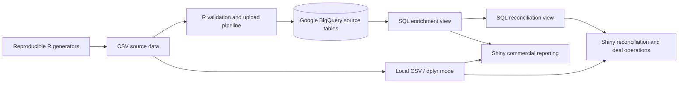

Music Revenue Intelligence
An end-to-end music revenue analytics and reconciliation project built with R, SQL, Google BigQuery and Shiny.

Streaming data can tell us how many times a recording was played. It is less straightforward to explain what those streams mean commercially: which markets generate the most revenue, why revenue changes between periods, how much should be allocated to a label, and whether that allocation agrees with the finance records.

I built this project to explore those questions through a reproducible data pipeline and an interactive reporting application. It brings together my interests in music, economics and data storytelling, with a particular focus on turning financial data into useful explanations rather than simply presenting totals.
Data disclosure: This is an independent portfolio project using entirely synthetic data. Artists, labels, streaming statements, commercial rates, distribution agreements, FX assumptions and ledger entries are fictional. The project is not affiliated with any music company or streaming service.

The questions I wanted to answer
- Commercial performance: Which platforms, markets and artists contribute most to gross streaming revenue? How efficiently does each market monetise its streams?
- Revenue movements: Was month-on-month growth driven by more streams, a shift in the geographic mix, or changes in revenue per stream?
- Financial control: Do expected label allocations agree with recorded finance amounts? Which differences deserve investigation?
- Operational follow-up: How could an analyst document exceptions, propose corrections and communicate the findings clearly?
What I built
Component	Implementation
Synthetic data generation	Seeded R scripts generate track-level streaming statements, artist and label catalogue records, distribution agreements and a simulated finance ledger. An optional extended scenario adds South Korea, fictional FX assumptions and deal terms.
Data engineering	A repeatable R pipeline validates source keys and required fields, uploads tables to BigQuery and refreshes reporting views.
SQL modelling	BigQuery views enrich streaming records with artist, label and agreement information, calculate expected label allocations and reconcile these with finance records.
Commercial reporting	An R Shiny dashboard uses Plotly and DT to visualise revenue trends, artist contribution, monetisation, platform and market mix, and a volume/mix/rate bridge.
Financial operations	An exception register records suspected causes, owners and follow-up notes. A separate page demonstrates illustrative minimum-guarantee top-ups and proposed rebills.
Quality controls	Checks cover missing values, duplicate source keys, unmatched catalogue or agreement records, and reconciliation outcomes.

System architecture

The dashboard can read from BigQuery or work with locally generated CSVs. Its Refresh button retrieves the latest available source data; it does not rerun or schedule the ingestion pipeline.
Dashboard walkthrough
1. Commercial Performance
The reporting page tracks gross streaming revenue, streaming volume, revenue per 1,000 streams and expected label revenue. Interactive filters let users explore the results by period, market, label and platform.

The part I found most interesting to build was the revenue bridge. Rather than just reporting that revenue increased, it decomposes the difference between the last two selected months into:
1. Streaming volume: the effect of a change in total streams, holding the previous market mix and monetisation constant.
2. Market mix: the effect of streams shifting between higher- and lower-monetising markets.
3. Within-market monetisation: the effect of changes in revenue per stream within each market.
The contributions add back to the overall revenue change. This is a descriptive decomposition, not proof of what caused the underlying commercial movements.

The dashboard also includes automatically generated observations, artist revenue share and a simple anomaly monitor. The original anomaly method compares each market with its preceding three months and flags deviations beyond two standard deviations. It is an exploratory screening tool—not a validated production detector.
2. Revenue Reconciliation
The model joins streaming statements to fictional commercial agreements to calculate an expected label allocation:
Expected label allocation = Gross streaming revenue (GBP) × Label share
Variance = Recorded label revenue − Expected label allocation
Expected values are aggregated at month × label × market level before comparison with the simulated finance ledger. A record is treated as an exception when its counterpart is missing or the absolute, two-decimal difference exceeds £0.50. Smaller rounding differences are within tolerance and are excluded from exception-exposure KPIs.

The extended six-month synthetic scenario contains 90 reconciliation groups and two deliberately inserted differences:
Scenario	Recorded less expected
January 2026 · Juniper Sound · Germany	+£125.40
February 2026 · Juniper Sound · United Kingdom	−£90.00
Absolute exception exposure	£215.40
Net exception variance	+£35.40

That gives 88 of 90 groups within tolerance (97.8%). The dashboard distinguishes the absolute value of unresolved discrepancies from the net amount after offsetting positive and negative variances.

An editable follow-up register lets an analyst record ownership, a suspected cause, status and evidence. These notes are written to a local CSV; they do not change the finance ledger or post accounting adjustments.
3. Deal Operations
A separate page illustrates a simplified monthly minimum-guarantee scenario:
Guarantee top-up = max(Monthly minimum guarantee − Expected allocation, 0)
Illustrative recharge = Expected allocation + Guarantee top-up
It also shows proposed corrective rebills for investigation. These calculations demonstrate how a revenue-operations workflow might be presented; they are not a model of actual contract accounting or legally payable amounts.
4. Methodology and Data Quality
The final page documents data provenance, reconciliation rules, analytical assumptions and limitations. The quality checks help distinguish source-data problems from discrepancies arising during financial reconciliation.
Demo dataset
The extended synthetic dataset used in the screenshots covers January–June 2026:
Dimension	Size
Fictional artists / tracks	10 artists / 30 tracks
Fictional labels	3
Streaming platforms	3
Markets	5: United Kingdom, United States, Germany, Japan and South Korea
Months	6
Track-level streaming records	2,700
Monthly reconciliation groups	90
Deliberately seeded finance discrepancies	2

The original generator produces a smaller four-market version. All rates and FX movements are illustrative, not observed industry payouts or historical exchange rates.
Run the project locally
You need R 4.1+ and RStudio (recommended). Clone or download the repository and set the working directory to the folder containing app.R.

1. Install packages (first run only):
install.packages(c(
  "shiny", "bslib", "dplyr", "plotly", "DT", "readr",
  "DBI", "bigrquery", "tidyverse"
))
2. Generate the extended sample data:
source("generate_data_extended.R")
This creates the data/raw/ CSV files; they are deliberately not committed to the repository.

3. Run validation tests:
source("tests/smoke_tests.R")
source("tests/artist_leaderboard_smoke_test.R")
4. Start the dashboard:
shiny::runApp(".", launch.browser = TRUE)
In the sidebar, change Data source from Google BigQuery to Local CSVs. The default BigQuery connection may show an authentication error until you switch source; no cloud credentials are needed for the local demonstration.
Optional: Run with BigQuery
To reproduce the cloud workflow, configure a Google Cloud project and BigQuery dataset, authenticate in R, and run:
bigrquery::bq_auth()
source("run_pipeline.R")
shiny::runApp(".", launch.browser = TRUE)
run_pipeline.R executes when sourced. It uploads the synthetic source tables, refreshes the SQL views and performs post-upload checks. The included SQL files contain the project's BigQuery identifiers, so update those identifiers before using a different cloud project. You can configure the R connection using MUSIC_BQ_PROJECT, MUSIC_BQ_DATASET and MUSIC_BQ_BILLING environment variables.

Important: the demonstration pipeline uses table replacement (overwrite = TRUE). Do not point it at real production data. BigQuery permissions and billing may be required.
Repository guide
music-revenue-intelligence/
├── app.R                          # Interactive Shiny dashboard
├── R/
│   └── analytics.R                # Reconciliation, bridge and analysis helpers
├── generate_data.R                # Sample Generator
├── run_pipeline.R                 # BigQuery upload, SQL refresh and validation
├── sql/
│   ├── 01_streaming_enriched.sql
│   └── 02_revenue_reconciliation.sql
├── tests/
│   ├── smoke_tests.R
│   └── artist_leaderboard_smoke_test.R
├── screenshots/
│   └── dashboard-overview.png
└── README.md
The data/raw/ and data/processed/ directories are created during use and are ignored by Git. Local follow-up notes and generated source files therefore remain outside the published repository.
Limitations and next steps
This project is a demonstration of analytical methods and workflow design, rather than a production royalty accounting system.
- The finance ledger is simulated from the same allocation model, with two deliberate discrepancies; reconciliation against an independent accounting source has not been demonstrated.
- Anomaly detection is basic: a three-month rolling standard deviation can exaggerate small movements and does not adjust for trends, seasonality or commercial materiality. A future version would use more history, minimum-impact rules and back-testing.
- Commercial assumptions are simplified: distribution rates, FX factors and monthly guarantees are fictional. Agreement validity dates and more complex recoupment terms would need additional modelling for real-world use.
- Pipeline execution is manual: the reporting refresh is not an automated scheduled ingestion process. A production implementation would add orchestration, schema-evolution checks, monitoring and access controls.
What I learned
The most useful lesson was that correctly calculating a revenue figure is only part of the analyst's job. It also matters whether that figure can be reconciled, whether a movement can be explained, what uncertainty remains, and how a stakeholder would act on the result. Building the same workflow across R, SQL, BigQuery and Shiny helped me connect data engineering with commercially useful reporting.
