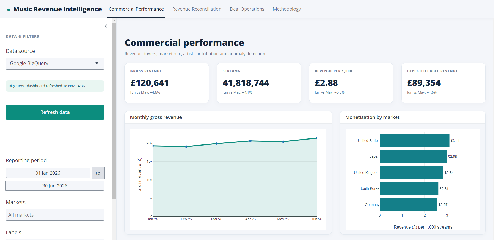
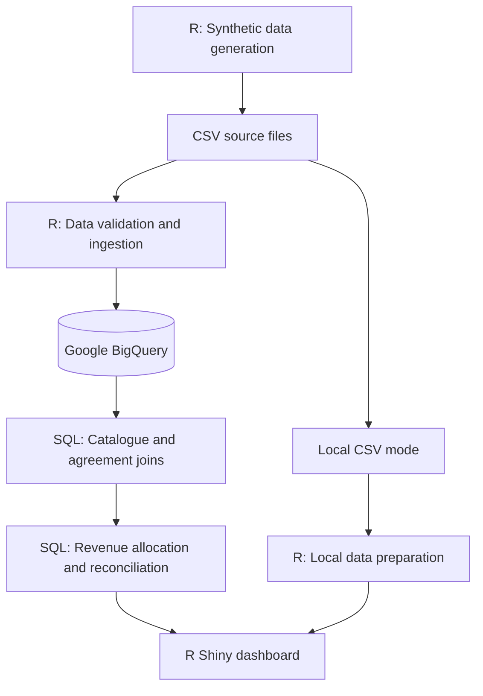
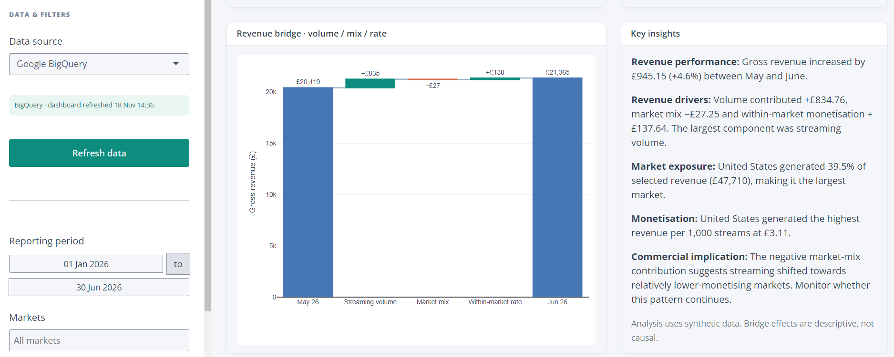
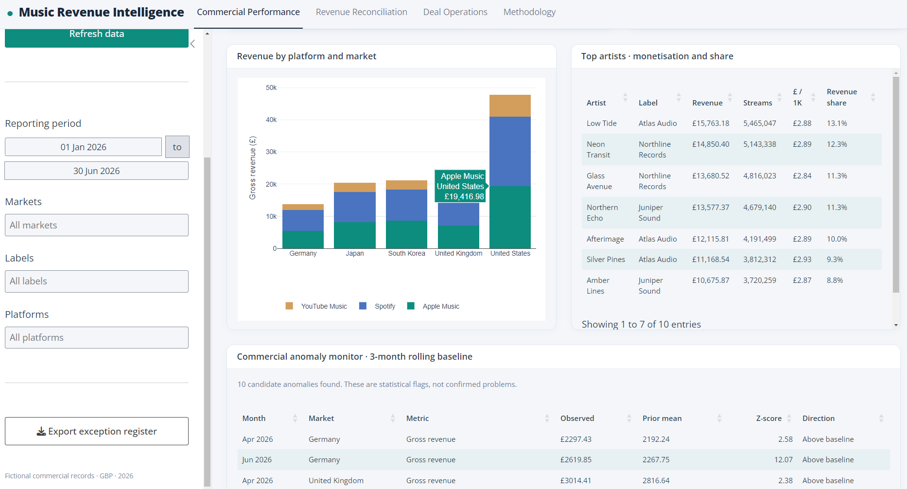
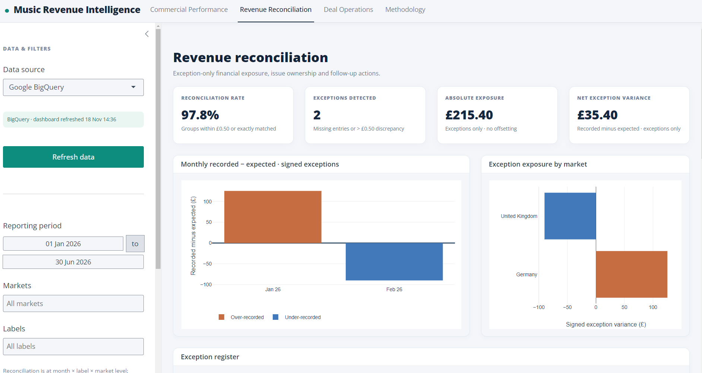
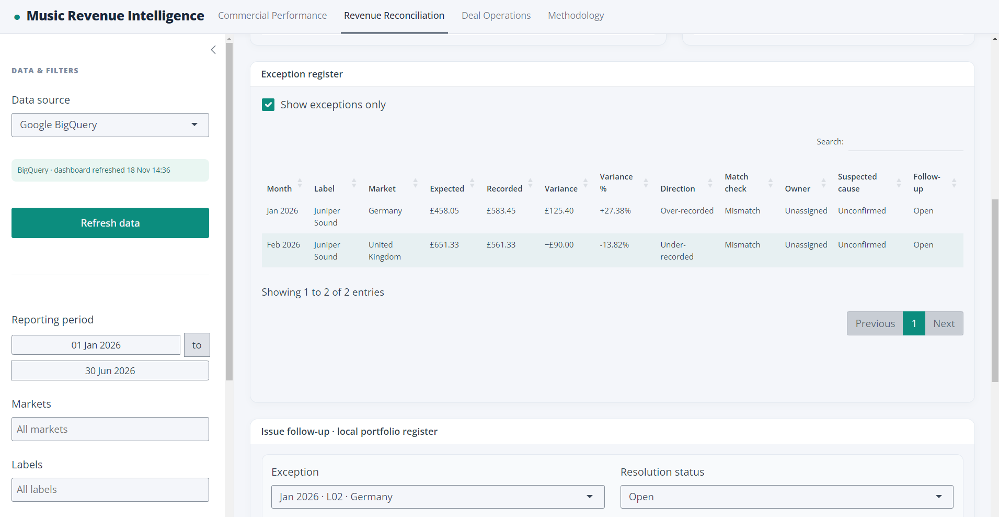
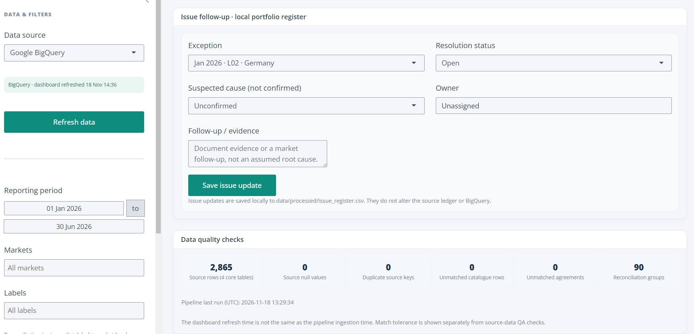
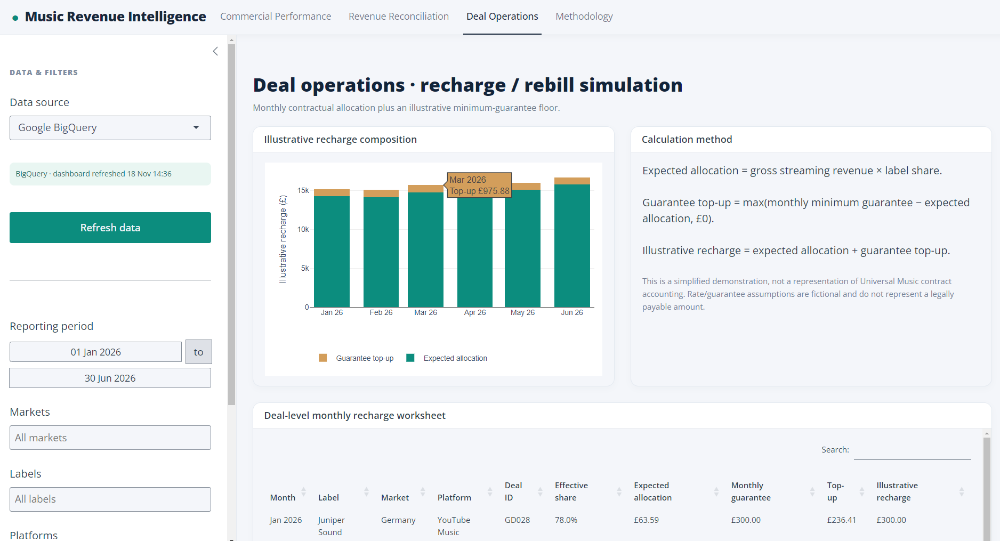
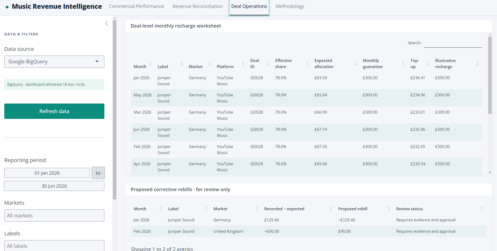
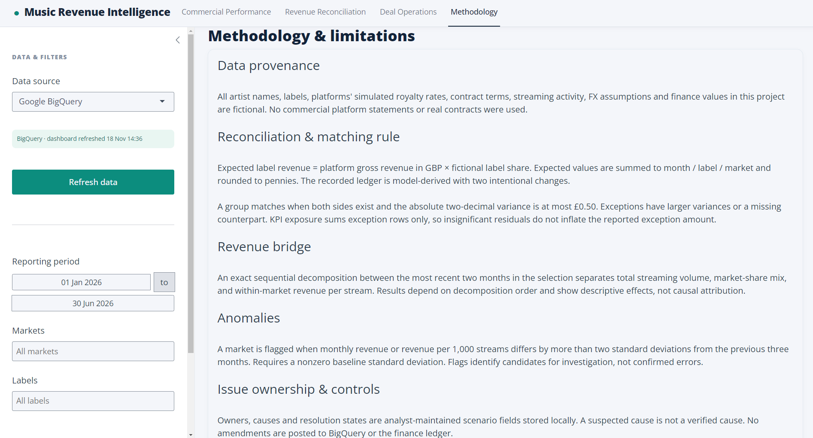

# Music Revenue Intelligence System

**An end-to-end music streaming revenue analysis and reconciliation project built with R, SQL, Google BigQuery and Shiny.**

Streaming figures tell us how many times a recording was played—but what do those streams mean commercially? Which artists and markets generate revenue? What drives monthly changes? And do the amounts allocated to labels agree with the financial records?

I built this project to explore those questions using a reproducible synthetic-data pipeline and an interactive analytical dashboard. It brings together my interests in **music, economics and data storytelling**, with an emphasis on interpreting performance and identifying discrepancies that warrant investigation.

> **Portfolio demonstration:** All artists, labels, activity, rates, contracts, exchange rates and financial records are **fictional**. This project is not affiliated with any music company or streaming platform.



## At a glance

| | Extended synthetic demonstration |
|---|---|
| Reporting period | January–June 2026 |
| Markets | United States, United Kingdom, Germany, Japan, South Korea |
| Streaming platforms | Spotify, Apple Music, YouTube Music |
| Fictional artists / tracks | 10 / 30 |
| Track-level streaming records | 2,700 |
| Month × label × market reconciliation groups | 90 |
| Deliberately seeded discrepancies | 2 |

## Questions I wanted to answer

- **Commercial performance:** Which platforms, markets and artists contribute most to streaming revenue, and how efficiently does each market monetise streams?
- **Revenue movements:** Is a change driven by streaming volume, geographic market mix or revenue per stream within a market?
- **Financial controls:** Do calculated label allocations match the amounts recorded in the simulated finance ledger?
- **Operational follow-up:** How can potential discrepancies be recorded, investigated and translated into proposed action?

## How the system works




| Layer | Implementation |
|---|---|
| **Data generation** | R creates streaming statements, artist and track catalogue data, distribution agreements, a simulated finance ledger and optional deal/FX data. |
| **Data engineering** | An R pipeline checks source data, uploads tables to BigQuery and refreshes reporting views. |
| **SQL analysis** | BigQuery views enrich streaming records, calculate label allocations and compare them with the ledger. |
| **Reporting** | R Shiny, Plotly and DT support filters, revenue visualisation, analysis, reconciliation and issue follow-up. |

The dashboard can query BigQuery or work from generated local CSVs. **Refreshing the dashboard reloads data; it does not rerun or schedule the ingestion pipeline.**

## Dashboard walkthrough

### 1. Commercial performance: understanding revenue drivers

The dashboard reports gross revenue, stream counts, revenue per 1,000 streams and expected label revenue. Filters allow exploration by date, market, label and platform.

A **revenue bridge** decomposes the movement between the most recent two selected months into:

1. **Streaming volume** — the contribution from the change in total streams.
2. **Market mix** — the contribution from streams shifting between markets with different historic monetisation rates.
3. **Within-market monetisation** — the contribution from changes in revenue per stream within each market.

For the synthetic May–June 2026 example, revenue increased by **£945.15**, comprising approximately **+£834.76 from volume**, **−£27.25 from market mix** and **+£137.64 from within-market monetisation**.



The dashboard generates short, data-driven commentary explaining these movements, market concentration and potential implications. In this example, the United States accounts for **39.5%** of selected gross revenue and has the highest revenue per 1,000 streams (**£3.11**).

These contributions are **descriptive and mathematically reconciled**, not proof of causal changes in listening behaviour or platform payment rates.

<details>
<summary><strong>Additional commercial analytics: platforms, artists and anomaly monitoring</strong></summary>

The dashboard also compares platform revenue by market and ranks artists by revenue, streams, revenue per 1,000 streams and share of selected revenue.

Its exploratory anomaly monitor compares monthly market revenue and monetisation with the preceding three months, flagging values more than two standard deviations from that baseline. With six months of simulated data, these are **candidate statistical flags**, not verified financial problems; the short baseline is an important limitation.



</details>

### 2. Revenue reconciliation: finding discrepancies

Streaming records are joined to a track catalogue and fictional distribution agreements. Expected label revenue is calculated as:

**Expected label revenue = Gross streaming revenue (GBP) × Fictional label share**

Expected allocations are aggregated by **month × label × market** and compared with the simulated financial ledger:

**Variance = Recorded label revenue − Expected label revenue**

A record is considered matched when both counterparts exist and its absolute two-decimal variance is **at most £0.50**. A missing counterpart or a larger difference is an exception.

| Simulated reconciliation outcome | Result |
|---|---:|
| Matched groups | 88 / 90 (97.8%) |
| January 2026 · Juniper Sound · Germany | **+£125.40** (over-recorded) |
| February 2026 · Juniper Sound · United Kingdom | **−£90.00** (under-recorded) |
| **Absolute exception exposure** | **£215.40** |
| **Net exception variance** | **+£35.40** |

The distinction between *absolute exposure* and *net variance* matters: opposite-signed discrepancies can offset in the net figure without reducing the total amount to investigate.



An exception register adds variance percentages, direction, suspected cause, owner and follow-up status. This moves the analysis beyond detecting a mismatch towards documenting how it might be investigated.



<details>
<summary><strong>Issue follow-up and source data-quality checks</strong></summary>

Notes and review status are saved to a **local CSV file**; no changes are posted to the underlying finance ledger or BigQuery. Data-quality checks separately report source null values, duplicate source keys and unmatched catalogue or agreement records.



</details>

### 3. Deal operations: simplified recharge and rebill scenarios

The Deal Operations page simulates fictional monthly contractual allocation and minimum-guarantee rules:

```text
Expected allocation = Gross streaming revenue × Label share
Guarantee top-up   = max(Monthly minimum guarantee − Expected allocation, £0)
Illustrative recharge = Expected allocation + Guarantee top-up
```

A deal-level worksheet shows the allocation, guarantee and resulting top-up.



The dashboard also translates reconciliation differences into **proposed corrective rebills for review**. These are scenarios, **not approved or automatically posted accounting entries**.



### 4. Methodology and transparency

The app documents the origin of its synthetic data, matching rules, revenue bridge assumptions, statistical limitations and issue-ownership controls.

<details>
<summary><strong>Methodology screenshot</strong></summary>



</details>

## Run the project locally

**Requirements:** R 4.1+ and an R environment such as RStudio. The source data are synthetic and generated locally; they are not committed to this repository.

1. Clone the repository and change into the **application directory** (not the repository root):

   ```bash
   git clone https://github.com/edblack014-alt/Synthetic-Music-Revenue-Intelligence-System.git
   cd Synthetic-Music-Revenue-Intelligence-System/music_revenue_shiny
   ```

2. Install the required R packages:

   ```r
   install.packages(c(
     "shiny", "bslib", "dplyr", "plotly", "DT", "readr",
     "DBI", "bigrquery", "tidyverse"
   ))
   ```

3. Generate the six-month, five-market sample dataset:

   ```r
   source("generate_data.R")
   ```

   This creates CSVs in `data/raw/`.

4. Run the included smoke checks:

   ```r
   source("tests/smoke_tests.R")
   ```

5. Start the app:

   ```r
   shiny::runApp(".", launch.browser = TRUE)
   ```

   Select **Local CSVs** in the sidebar. The app defaults to BigQuery, so you may initially see an authentication or connection message before switching modes. **You do not need Google Cloud credentials for Local CSV mode.**

### Optional: reproduce the BigQuery pipeline

The R ingestion script is located at `music_revenue_shiny/run_pipeline.R`. To use it, configure your own Google Cloud project, dataset and billing identifiers, **update the project/dataset names hard-coded in the SQL view scripts**, and authenticate using `bigrquery`.

From inside `music_revenue_shiny/`:

```r
Sys.setenv(
  MUSIC_BQ_PROJECT = "YOUR_PROJECT_ID",
  MUSIC_BQ_DATASET = "YOUR_DATASET_ID",
  MUSIC_BQ_BILLING = "YOUR_BILLING_PROJECT_ID"
)
bigrquery::bq_auth()
source("run_pipeline.R")
```

**Important:** `run_pipeline.R` executes when sourced and **overwrites** the target synthetic source tables. Do not point it at a production dataset. The pipeline is repeatable, not scheduled.

## Repository layout

```text
Synthetic-Music-Revenue-Intelligence-System/
├── README.md
├── screenshots/                  # Dashboard screenshots used above
│   ├── 01-commercial-performance-overview.png
│   ├── 02-revenue-bridge-and-insights.png
│   ├── ...
│   └── 09-methodology-and-limitations.png
└── music_revenue_shiny/          # Set this as the R working directory
    ├── app.R
    ├── R/
    │   └── analytics.R
    ├── generate_data.R
    ├── run_pipeline.R
    ├── sql/
    │   ├── 01_streaming_enriched.sql
    │   └── 02_revenue_reconciliation.sql
    └── tests/
        └── smoke_tests.R
```

The `data/raw/` and `data/processed/` folders are created while running the project. Avoid committing authentication material or locally maintained investigation records.

## Limitations and next steps

This is a portfolio demonstration, **not a production music royalty-accounting platform**.

- **Synthetic ledger:** Its values are derived from the allocation model, with two injected exceptions. The system has not been tested against an independent real-world finance ledger.
- **Exploratory anomaly detection:** Three prior months are too few to estimate a robust baseline or account for seasonality, trends and commercial materiality. A next step would be to extend the data history, establish business thresholds and back-test detection quality.
- **Simplified deal terms:** The recharge model uses fictional rates and monthly guarantees; it does not cover recoupment, complex real agreements or full effective-date validation.
- **Pipeline operations:** The ingestion is run manually. A production implementation would require scheduling, schema-evolution handling, secure access controls, monitoring and audit logging.

## What I learned

The most useful lesson was that calculating revenue is only part of an analyst's job. It also matters whether a result can be reconciled, whether a movement can be explained, what remains uncertain and how stakeholders might use the analysis.

Building across **R, SQL, BigQuery and Shiny** helped me connect data preparation and validation with commercially useful reporting, financial controls and clear communication.
